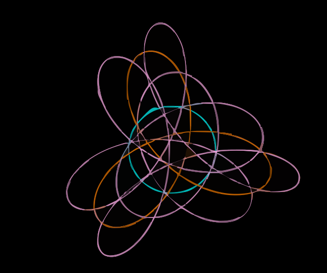

# 🌀 OrbitArms

A web app for drawing interactive spirograph-style patterns using animated rotating arms. Configure multiple arms with custom lengths, speeds, and colors to generate beautiful Lissajous / spirograph curves in real time.



---

## ✨ Features

- **Multi-arm chain** — Add as many rotating arms as you like, each chained from the tip of the previous one
- **Live controls** — Adjust each arm's length, angular velocity, and initial angle in real time without stopping the animation
- **Trail drawing** — Each arm's end-effector traces a colored trail on the canvas, building up the spirograph pattern over time
- **Per-arm customization** — Toggle arm visibility, enable/disable trail drawing, and pick custom colors per arm
- **Global settings** — Control arm stroke width and canvas background color (black or white)
- **Responsive canvas** — Auto-scales to fit the available screen space; handles window resize gracefully
- **Play / Pause / Clear** — Pause the animation at any time or wipe the canvas to start fresh

---

## 🚀 Getting Started

### Prerequisites

- [Node.js](https://nodejs.org/) v18+
- npm

### Install & Run

```bash
# Clone the repository
git clone https://github.com/Oscar-Yam/OrbitArms.git
cd OrbitArms

# Install dependencies
npm install

# Start the development server
npm run dev
```

Then open [http://localhost:5173/OrbitArms](http://localhost:5173/OrbitArms) in your browser.

### Other Scripts

| Command | Description |
|---|---|
| `npm run dev` | Start the Vite development server |
| `npm run build` | Type-check and build for production |
| `npm run preview` | Preview the production build locally |
| `npm run lint` | Run ESLint |

---

## 🎮 How to Use

1. **Add / Remove Arms** — Use the *Add Arm* and *Remove Last Arm* buttons in the Arms Settings panel.
2. **Configure each arm** — For each arm you can set:
   - **Length** (1–50 units)
   - **ω (deg/s)** — Angular velocity in degrees per second (negative = clockwise)
   - **θ₀ (deg)** — Initial angle offset in degrees
   - **Show arm** — Toggle visibility of the arm line itself
   - **Draw trail** — Toggle whether this arm leaves a trail
   - **Color** — Pick the trail color with the color picker
3. **Global Settings:**
   - **Arm Width** — Stroke width for both arms and trails
   - **Background** — Switch between black and white canvas
4. **Canvas Controls:**
   - **Pause / Play** — Freeze or resume the animation
   - **Clean Canvas** — Clear all trails and reset time to zero
5. **Collapse Panel** — Click *Collapse* to shrink the settings panel and give the canvas more space.

---

## 🧠 How It Works

Each arm in the chain rotates around the tip of the previous arm. The angle of arm `i` at time `t` is:

```
θᵢ(t) = initialAngle + angularVelocity × t
```

The end-effector position is the sum of all arm vectors:

```
x = Σ length_i × cos(θᵢ)
y = Σ length_i × sin(θᵢ)
```

This is identical to a **Fourier epicycle** decomposition — by tuning the angular velocities and lengths you can approximate any closed curve.

---

## 🗂 Project Structure

```
OrbitArms/
├── src/
│   ├── main.tsx          # React entry point
│   ├── App.tsx           # Root component — UI layout & state management
│   ├── OrbitCanvas.tsx   # Canvas rendering, animation loop, trail tracking
│   ├── arm.ts            # Arm interface & factory function
│   ├── armMath.ts        # Math utilities (joint positions, end-effector)
│   ├── App.css           # App-level styles
│   └── index.css         # Global styles
├── public/
├── index.html
├── vite.config.ts
├── tsconfig.json
└── package.json
```

---

## 🛠 Tech Stack

| Technology | Version |
|---|---|
| React | ^19 |
| TypeScript | ~5.9 |
| Vite | ^7 |
| ESLint | ^9 |

---

## 📄 License

This project is open source. Feel free to fork, modify, and share!
