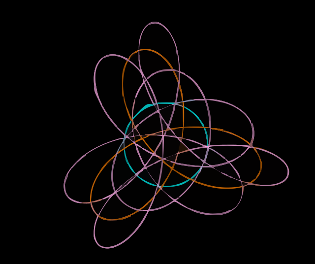

# 🌀 OrbitArms

A web app for drawing interactive spirograph-style patterns using animated rotating arms. Configure multiple arms with custom lengths, speeds, and colors to generate beautiful Lissajous / spirograph curves in real time — in both **2D** and **3D**.



---

## ✨ Features

### Shared (2D & 3D)
- **Multi-arm chain** — Add as many rotating arms as you like, each chained from the tip of the previous one
- **Live controls** — Adjust each arm's length, angular velocity, and initial angle in real time without stopping the animation
- **Numeric inputs** — Type any value freely; fields commit only on blur (no mid-type reformatting)
- **Trail drawing** — Each arm's end-effector traces a colored trail on the canvas
- **Per-arm customization** — Toggle arm visibility, enable/disable trail drawing, and pick custom colors
- **Trail width & trail length** — Global controls for stroke width and how many trail dots are kept
- **Auto-scale** — The scene always fits 90% of the canvas regardless of arm lengths
- **Play / Pause / Clear** — Pause the animation or wipe all trails at any time
- **Collapsible panel** — Shrink the settings panel to give the canvas more room; canvas auto-stretches via ResizeObserver
- **Background color** — Switch between black and white canvas
- **Export / Import** — Encode the full arm configuration as a short passcode string and restore it later
- **Responsive canvas** — Handles panel collapse and window resize gracefully

### 3D Mode extras
- **3-axis orbit view** — Drag the canvas to rotate the scene (yaw + pitch) with perspective projection and depth-based opacity
- **Per-arm 3D parameters** — Separate angular velocity and initial angle for X, Y, and Z axes
- **3-axis indicator** — Colour-coded X (red) / Y (green) / Z (blue) lines at the origin; toggleable via **Show Axes** checkbox
- **Reset camera** — One-click button to return to the default yaw/pitch
- **Separate codec** — 3D passcodes use prefix `OA3D1:` and are incompatible with 2D codes by design

---

## 🚀 Getting Started

### Prerequisites

- [Node.js](https://nodejs.org/) v18+
- npm

### Install & Run

```bash
# Clone the repository
git clone https://github.com/Oscar-Yam/OrbitArms.git
cd OrbitArms

# Install dependencies
npm install

# Start the development server
npm run dev
```

Then open [http://localhost:5173/OrbitArms](http://localhost:5173/OrbitArms) in your browser.

### Other Scripts

| Command | Description |
|---|---|
| `npm run dev` | Start the Vite development server |
| `npm run build` | Type-check and build for production |
| `npm run preview` | Preview the production build locally |
| `npm run lint` | Run ESLint |

---

## 🎮 How to Use

### 2D Mode

1. **Add / Remove Arms** — Use the *Add Arm* and *Remove Last Arm* buttons in the Arms Settings panel.
2. **Configure each arm:**
   - **Length** (1–50 units)
   - **ω (deg/s)** — Angular velocity in degrees per second (negative = clockwise)
   - **θ₀ (deg)** — Initial angle offset in degrees
   - **Show arm** — Toggle visibility of the arm bone
   - **Draw trail** — Toggle whether this arm leaves a trail
   - **Color** — Trail colour picker
3. **Global Settings:**
   - **Trail Width** — Stroke width for arms and trails
   - **Trail Length** — Number of trail dots kept per arm (100–10 000)
   - **Background** — Black or white canvas
4. **Canvas Controls (overlay):**
   - **⏸ / ▶** — Pause / resume the animation
   - **🗑** — Clear all trails
5. **Export / Import** — Encode your setup as a passcode to save or share it.

### 3D Mode

Same as 2D, plus:

1. **Each arm has 3 angular velocities** (ωX, ωY, ωZ) and **3 initial angles** (θ₀X, θ₀Y, θ₀Z).
2. **Drag the canvas** to rotate the camera (yaw + pitch).
3. **Canvas Controls (overlay):**
   - **⏸ / ▶** — Pause / resume
   - **🗑** — Clear all trails
   - **⟳** — Reset camera to default orientation
4. **Show Axes** checkbox (header bar) — toggle the X/Y/Z axis indicator.
5. **Background** selector and **Export / Import** work the same as 2D but use the 3D codec.

---

## 🧠 How It Works

### 2D

Each arm rotates around the tip of the previous one. The angle of arm `i` at time `t` is:

```
θᵢ(t) = initialAngle + angularVelocity × t
```

The end-effector position is the sum of all arm vectors:

```
x = Σ lengthᵢ × cos(θᵢ)
y = Σ lengthᵢ × sin(θᵢ)
```

This is identical to a **Fourier epicycle** decomposition — by tuning the angular velocities and lengths you can approximate any closed curve.

### 3D

Each arm rotates independently around the X, Y, and Z axes (applied as successive Rodrigues rotations). The projected screen position is computed with a **perspective projection** using a fixed focal length, and depth modulates opacity so closer segments appear brighter. The camera is a simple yaw/pitch rotation applied to every world-space point before projection.

---

## 🗂 Project Structure

```
OrbitArms/
├── src/
│   ├── main.tsx               # React entry point
│   ├── App.tsx                # Root component — page routing
│   ├── OrbitCanvas.tsx        # 2D canvas rendering & animation loop
│   ├── arm.ts                 # 2D Arm interface & factory
│   ├── armMath.ts             # 2D math utilities
│   ├── armCodec.ts            # 2D export/import codec  (prefix OA1:)
│   ├── arm3d.ts               # 3D Arm interface & factory
│   ├── armMath3d.ts           # 3D math, perspective projection, camera
│   ├── armCodec3d.ts          # 3D export/import codec  (prefix OA3D1:)
│   ├── pages/
│   │   ├── Page2D.tsx         # 2D page — layout, panel, controls
│   │   └── Page3D.tsx         # 3D page — layout, panel, rAF draw loop
│   ├── components/
│   │   └── NumericInput.tsx   # Reusable number input (commits on blur)
│   ├── App.css
│   └── index.css
├── public/
├── index.html
├── vite.config.ts
├── tsconfig.json
└── package.json
```

---

## 🛠 Tech Stack

| Technology | Version |
|---|---|
| React | ^19 |
| TypeScript | ~5.9 |
| Vite | ^7 |
| ESLint | ^9 |

---

## 📄 License

This project is open source. Feel free to fork, modify, and share!
